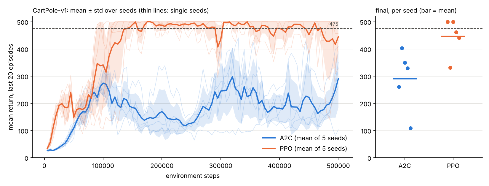

# Actor-critic with GAE, and PPO, from scratch

My own implementation of A2C with Generalised Advantage Estimation in PyTorch, using Gymnasium's vector environments. I then added a PPO update on top of the same code and compared the two on CartPole-v1.

I built this as the step between REINFORCE and multi-agent RL, and as a way to get properly comfortable with writing RL code myself. The rollout, advantage, loss and update code is all mine. I had help with the plotting, the seed runner and the README layout.

## Where things stand

- A2C learns CartPole, but it does **not** hold a good policy. It climbs to 400-470, then falls back. It fails my own acceptance check (last-20 mean of 475 or more, within 500k steps, on at least 4 of 5 seeds).
- PPO gets to 475 on all 5 seeds, but only 2 of 5 are still above 475 at the end of the run.
- Not done yet: the λ sweep, the truncation ablation and Acrobot (see the end).

## The comparison

Left: mean return of the last 20 finished episodes against environment steps. The thick line is the mean over seeds 0-4, the shaded band is ± one standard deviation and the thin lines are single seeds. Right: where each seed ended (mean of its last 20 episodes). The dashed line is 475.

| | A2C | PPO |
|---|---|---|
| Reaches 475 at some point | 1 of 5 (seed 2, once at 357k steps, then drops to 88) | 5 of 5 (first at 88k, 98k, 88k, 140k, 113k steps) |
| Still at 475 or more at the end | 0 of 5 | 2 of 5 (seeds 0 and 2) |
| Final value, seeds 0 to 4 | 261, 402, 350, 329, 109 | 500, 331, 500, 461, 441 |
| Mean of the five finals | 290 | 447 |

Whether PPO "passes" depends on how you read the check: 5 of 5 if reaching 475 is enough, 2 of 5 if it has to finish there. A2C fails either way.

Setup, the same for both: seeds 0-4, 500k environment steps, 8 environments x 32 steps per update, γ 0.99, λ 0.95, value coefficient 0.5, entropy coefficient 0.01, gradient clipping at 0.5 (separately for actor and critic), two hidden layers of 32 units, Adam, advantage normalisation on. Actions are sampled from the policy, there is no greedy evaluation.

- **A2C:** learning rate 7e-4, one gradient step per rollout. I tuned this by hand on seed 3 only (table below), and seed 3 is one of the five test seeds, so A2C had a small advantage.
- **PPO:** learning rate 3e-4, clip 0.2, 4 epochs per rollout, minibatches of 64. I ran it once and did not tune it.

### What PPO does after it gets there

Once PPO reaches 475, the last-20 mean stays at 475 or above for 78%, 57%, 93%, 71% and 72% of the later episodes (seeds 0-4). The dips come from the odd very short episode in a run of 500s. Seed 1 had 59 episodes under 50 steps after first reaching 475, seed 3 had 21, seed 4 had 15, seeds 0 and 2 had 1 each. A single one of those in a window of 20 costs about 24 points. I don't know why they happen and haven't looked into it yet.

On seed 1, PPO is actually the weaker one at the end (331 against 402 for A2C).

### What this does not show

- PPO does 16 gradient steps per rollout and A2C does 1, and the learning rates differ. So I can't say the clipped objective is the reason PPO does better. A PPO run with the clip effectively switched off would help separate those, and I haven't done it.
- A2C was tuned on one of the test seeds and PPO wasn't tuned at all, so neither side is a best case.
- Five seeds is small and the spread between seeds is big.
- One environment, one network size.

## A2C tuning runs (seed 3 only)

Seed 3, 8 environments, 500k steps, γ 0.99, λ 0.95, value coefficient 0.5, two hidden layers of 32. A random policy scores 23.5. "Last 20" is the mean return of the last 20 finished training episodes.

| Run | Rollout length | Learning rate | Grad clipping | Adv. normalisation | Entropy coef. | Best last-20 (at steps) | Last 20 at end |
|---|---|---|---|---|---|---|---|
| 1 | 16 | 3e-4 | joint | on | 0.01 | 470 (461k) | 88 |
| 2 | 32 | 3e-4 | joint | on | 0.01 | 275 (333k) | 177 |
| 3 | 32 | 7e-4 | joint | on | 0.01 | 399 (230k) | 171 |
| 4 | 32 | 7e-4 | joint | on | 0.001 | 381 (269k) | stopped at 410k |
| 5 | 32 | 7e-4 | separate | on | 0.01 | 403 (320k) | 329 |
| 6 | 32 | 7e-4 | separate | off | 0.01 | 453 (384k) | 279 |

Run 5 is what I used for the five-seed comparison (it is seed 3 there, 329.4 at the end in both). The logs are in `results/a2c_tuning/`. Runs 1 and 6 are excerpts because I didn't keep every printed line.

What I take from these, and what I don't:

- The code learns. Every run goes from about 23 to somewhere between 275 and 470.
- No run holds its peak. Each reaches 400-470 and then drops sharply (run 4 went from 380 to 67 in about 13k steps), usually with big spikes in the value loss.
- Changing the rollout length, learning rate, entropy weight, clipping and advantage normalisation changed when the swings happened, but none of them stopped them. Policy entropy stayed around 0.55-0.60 in every run (0.69 would be uniform over two actions).
- Each row is one seed, so I wouldn't read much into the differences between rows. Separate clipping gave the best final value, but that is one run.

## What's in the code

- `rollout.py`: steps N environments together and stores state, action, old log-prob, reward, V(s_t) and V(s_t+1) as `[T, N]` tensors, with no gradients. When an episode ends, V(s_t+1) comes from the real final observation (`info["final_obs"]`), not the reset one.
- Termination vs truncation: only `terminated` turns off the bootstrap. A time limit or the end of the rollout still bootstraps from the critic. The GAE chain is cut at either, so advantages don't leak between episodes.
- `advantages.py`: bootstrapped returns, TD(0) advantages and GAE(λ).
- `update.py`: the A2C update. Policy-gradient loss with GAE advantages, value loss against the λ-return, an entropy bonus, gradient clipping per network, and Adam.
- `ppo_update.py`: clipped-ratio loss, several epochs per rollout with shuffled minibatches, same value loss and entropy bonus, and `approx_kl` and `clip_fraction` printed as diagnostics.
- `networks.py`: separate actor and critic MLPs, nothing shared.
- `train.py`: collect, update, log. Prints losses, entropy and the last-20 mean every 50 updates and writes every finished episode to a CSV. It still contains an old random-policy baseline that `main` no longer calls.

## Checks

- `tests/test_networks.py`: output shapes, no shared parameters, critic output not squashed.
- `tests/test_advantages.py`: on a small rollout with a termination, a truncation and a step with both, GAE with λ=0 matches TD(0), and GAE with λ=1 matches bootstrapped return minus V(s_t). Two more tests (a hand-worked case and a direct truncation check) are still stubs and marked as skipped.
- `scripts/check_rollout.py`: shapes, no gradients in stored tensors, one recorded return per episode end, and with a forced 10-step time limit, the final-observation value differs from the next-state value on all 96 of 96 final steps.
- `scripts/check_update.py`: before the first update, the recomputed log-probs match the stored ones to about 6e-8, so observations, actions and ordering line up after flattening. For PPO the ratio on the first minibatch is 1 to within 1.2e-7.

## Running it

From the project folder, with the packages in `requirements.txt` installed:

    python -m actor_critic_gae.train --algo a2c --lr 0.0007 --total-steps 500000 --seed 3
    python -m actor_critic_gae.train --algo ppo --lr 0.0003 --total-steps 500000 --seed 3
    python -m pytest -v

The default learning rate in `config.py` is the PPO one (3e-4), so A2C needs `--lr 0.0007`.

Five seeds and the figure:

    python scripts/run_seeds.py --algo ppo --lr 0.0003 --seeds 0 1 2 3 4
    python scripts/run_seeds.py --algo a2c --lr 0.0007 --seeds 0 1 2 3 4
    python scripts/plot_results.py --algos a2c ppo

Each run saves `results/runs/<algo>_seed<S>.csv` (every finished episode: steps, return) and the printed log next to it. All ten runs from the table above are in that folder. Everything else (clip, epochs, minibatch size and so on) is in `config.py`.

## Still to do

- PPO with the clip switched off, to see how much of the gap is the clip and how much is the extra gradient steps.
- λ sweep over {0, 0.5, 0.9, 0.95, 1.0} on 5 seeds, the truncation-as-termination ablation, and Acrobot-v1.
- Greedy evaluation of the trained policies, and a decaying learning rate for A2C.
- Find out why PPO sometimes has those very short episodes.
- Fill in the two skipped tests.
