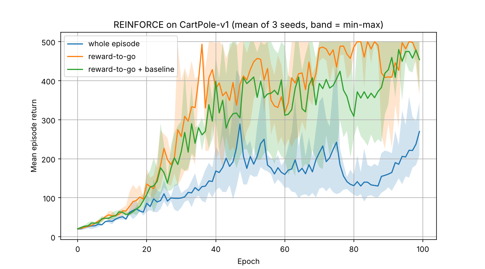

# REINFORCE on CartPole

## Files

- `REINFORCE_CartPole.py`: the algorithm. `train()` can use the whole-episode return or reward-to-go, with an optional baseline.
- `run_experiment.py`: runs 3 settings with 3 seeds each for 100 epochs. It saves every run to `results.csv` and plots `returns_comparison.png`.
- `returns_comparison.png`: the plot from one run of `run_experiment.py`.

## Requirements

`torch`, `gymnasium`, `numpy`, `pandas`, `matplotlib`.

## Running one training run

    python REINFORCE_CartPole.py                        # reward-to-go (default)
    python REINFORCE_CartPole.py --whole_episode_return
    python REINFORCE_CartPole.py --baseline --seed 1
    python REINFORCE_CartPole.py --render               # opens the CartPole window

Other options: `--lr`, `--gamma`, `--env_name`.

## Running the comparison

Run it from this folder, because `run_experiment.py` imports `REINFORCE_CartPole.py`:

    python run_experiment.py

It takes several minutes on a CPU.

## Results

Mean episode return over the last 10 of 100 epochs, from one run on CPU:

| Setting | Seed 0 | Seed 1 | Seed 2 |
|---|---|---|---|
| Whole-episode return | 164 | 286 | 169 |
| Reward-to-go | 473 | 407 | 500 |
| Reward-to-go + baseline | 443 | 500 | 427 |

Whole-episode weighting is clearly the worst setting. Reward-to-go with and without the baseline are close, and with three seeds the difference between them is within the noise. Run more seeds before drawing a conclusion.
